

<a href="https://humraz.vercel.app/">
<picture>
  <source media="(prefers-color-scheme: dark)" srcset="assets/hero-dark.svg">
  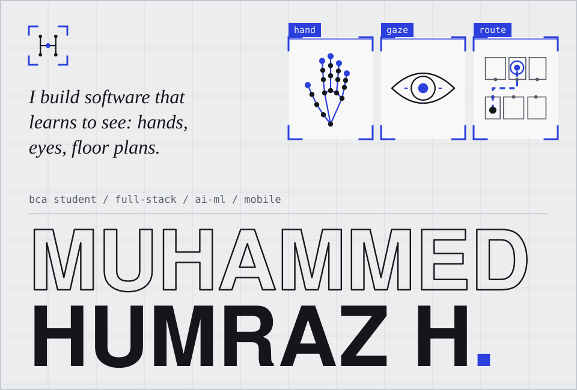
</picture>
</a>

<a href="#work"><b>Selected work</b></a> &nbsp;/&nbsp; <a href="https://humraz.vercel.app/"><b>Portfolio</b></a> &nbsp;/&nbsp; <a href="#contact"><b>Contact</b></a>

<table>
<tr><th align="left" colspan="2">Index</th></tr>
<tr><td width="190"><a href="#about"><b>01 About</b></a></td><td>How I work and what keeps pulling me in.</td></tr>
<tr><td><a href="#work"><b>02 Selected work</b></a></td><td>Five projects: the problem, what I built, what it runs on.</td></tr>
<tr><td><a href="#capabilities"><b>03 Capabilities</b></a></td><td>The tools I have actually shipped with.</td></tr>
<tr><td><a href="#now"><b>04 Now</b></a></td><td>What I am building and learning at the moment.</td></tr>
<tr><td><a href="#beyond"><b>05 Beyond code</b></a></td><td>Student communities and the MuLearn campus lead role.</td></tr>
<tr><td><a href="#activity"><b>06 Activity</b></a></td><td>Contribution calendar and languages.</td></tr>
<tr><td><a href="#contact"><b>07 Contact</b></a></td><td>Portfolio, LinkedIn, GitHub, email.</td></tr>
</table>

<h2><picture><source media="(prefers-color-scheme: dark)" srcset="assets/h-about-dark.svg">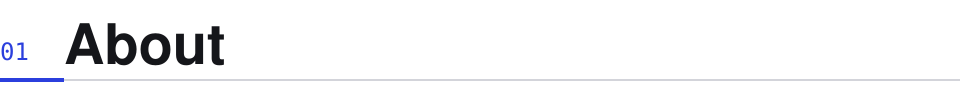</picture></h2>

I'm a BCA student, and I keep getting drawn to the same kind of problem: making software notice something a person does without thinking. A hand shape. Where someone is looking. The way you'd walk to a room you've never been to.

Those became **SignSpeak AI**, which recognises signs a user teaches it and speaks them back with a Malayalam translation; **Eye Canvas**, where you draw by looking and blinking; and **WayFind**, which plans indoor routes with A\*.

Around those experiments I build the parts that make something a product instead of a demo: logins, admin panels, databases, a Flutter app that works with no internet. Most of my repositories are full stack because an idea isn't finished until someone else can sign in and use it.

I started in design, and it still shows. I usually know how a screen should feel before I know how it's wired.

<h2><picture><source media="(prefers-color-scheme: dark)" srcset="assets/h-work-dark.svg">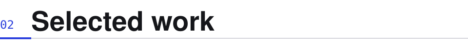</picture></h2>

<a href="https://github.com/mhd-humraz/sign-language-transilator"><picture><source media="(prefers-color-scheme: dark)" srcset="assets/work-signspeak-dark.svg">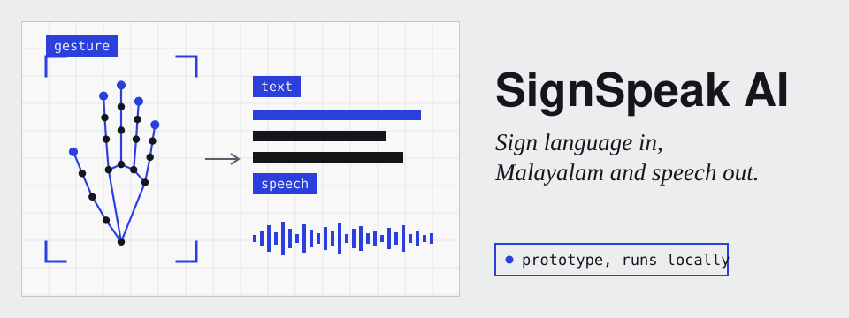</picture></a>

<table>
<tr><th align="left" width="130">Problem</th><td>Sign recognition that fits the signer rather than a fixed vocabulary: each user records their own gestures, trains a model on them, and gets live recognition with a Malayalam translation and spoken output.</td></tr>
<tr><th align="left">What I built</th><td>The whole pipeline: webcam capture of MediaPipe hand landmarks, per-user training with Random Forest, KNN or SVM, a Django backend with accounts and a REST API, and a recognition screen that speaks the result through the browser's Web Speech API.</td></tr>
<tr><th align="left">Built with</th><td><code>Django</code> <code>Django REST Framework</code> <code>MediaPipe</code> <code>OpenCV</code> <code>scikit-learn</code> <code>NumPy</code> <code>SQLite</code></td></tr>
<tr><th align="left">Status</th><td>Prototype. Runs locally, with a setup guide in the repository.</td></tr>
<tr><th align="left">Links</th><td><a href="https://github.com/mhd-humraz/sign-language-transilator">Repository</a></td></tr>
</table>

<a href="https://github.com/mhd-humraz/wayfind"><picture><source media="(prefers-color-scheme: dark)" srcset="assets/work-wayfind-dark.svg">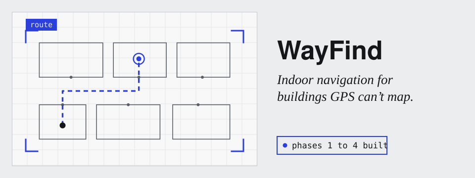</picture></a>

<table>
<tr><th align="left" width="130">Problem</th><td>Finding a room inside a large building, where GPS stops helping. Visitors need a route without creating an account, and building admins need a way to describe the building.</td></tr>
<tr><th align="left">What I built</th><td>Both sides. An admin area with an SVG floor-plan editor for drawing walkable paths between rooms, stairs and elevators, and a public search with typo-tolerant matching that returns an A* route. It also covers accessible-only routing, QR positioning and emergency-exit routing.</td></tr>
<tr><th align="left">Built with</th><td><code>Next.js</code> <code>TypeScript</code> <code>Tailwind CSS</code> <code>PostgreSQL</code> <code>Prisma</code> <code>Auth.js</code> <code>Zod</code></td></tr>
<tr><th align="left">Status</th><td>Phases 1 to 4 are built. No hosted demo yet.</td></tr>
<tr><th align="left">Links</th><td><a href="https://github.com/mhd-humraz/wayfind">Repository</a></td></tr>
</table>

<a href="https://github.com/mhd-humraz/college-erp"><picture><source media="(prefers-color-scheme: dark)" srcset="assets/work-edusphere-dark.svg">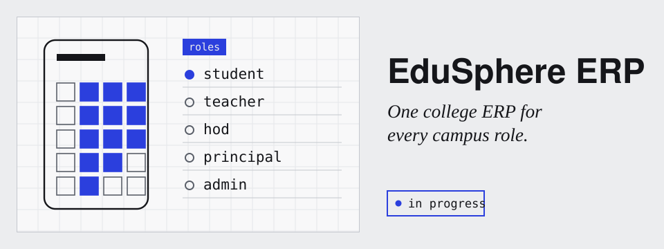</picture></a>

<table>
<tr><th align="left" width="130">Problem</th><td>Campus operations such as attendance, timetables, the library and reports, in one app that shows each person only what their role needs.</td></tr>
<tr><th align="left">What I built</th><td>A Flutter app with separate modules for students, teachers, HODs, the principal and admins, including attendance, timetable and library QR-scanning screens and a campus map view. Behind it, a Node and Express API with JWT authentication, role-based authorisation and a 17-collection MongoDB schema.</td></tr>
<tr><th align="left">Built with</th><td><code>Flutter</code> <code>Dart</code> <code>Provider</code> <code>Go Router</code> <code>Node.js</code> <code>Express</code> <code>MongoDB</code> <code>JWT</code></td></tr>
<tr><th align="left">Status</th><td>In progress. The foundation and role modules are in place, and more features are planned.</td></tr>
<tr><th align="left">Links</th><td><a href="https://github.com/mhd-humraz/college-erp">App</a> &nbsp;/&nbsp; <a href="https://github.com/mhd-humraz/edu">Foundation and API</a></td></tr>
</table>

<a href="https://github.com/mhd-humraz/Certify"><picture><source media="(prefers-color-scheme: dark)" srcset="assets/work-certifypro-dark.svg">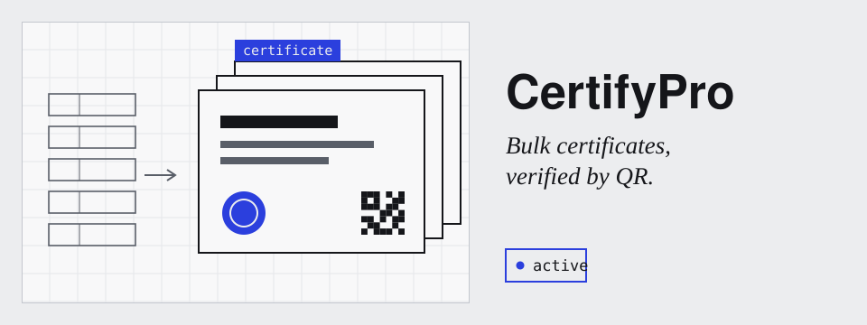</picture></a>

<table>
<tr><th align="left" width="130">Problem</th><td>Issuing certificates for an event by hand, and giving nobody an easy way to check that one is genuine.</td></tr>
<tr><th align="left">What I built</th><td>Upload a template and a CSV or Excel sheet and it generates every certificate with a unique ID and QR code, emails them out, and bundles a ZIP. A public page lets anyone verify a certificate by ID or QR scan, and a dashboard tracks what was sent.</td></tr>
<tr><th align="left">Built with</th><td><code>Django</code> <code>ReportLab</code> <code>Pillow</code> <code>qrcode</code> <code>pandas</code> <code>PostgreSQL</code> <code>Docker</code> <code>Bootstrap</code></td></tr>
<tr><th align="left">Status</th><td>Active.</td></tr>
<tr><th align="left">Links</th><td><a href="https://github.com/mhd-humraz/Certify">Repository</a></td></tr>
</table>

<a href="https://github.com/mhd-humraz/pockiva"><picture><source media="(prefers-color-scheme: dark)" srcset="assets/work-pockiva-dark.svg">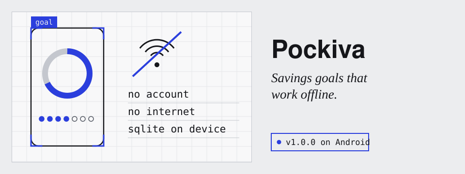</picture></a>

<table>
<tr><th align="left" width="130">Problem</th><td>Tracking a savings goal without signing up for anything.</td></tr>
<tr><th align="left">What I built</th><td>An offline-first Android app: multiple goals, flexible or fixed daily savings plans, a progress dashboard and light and dark themes, with everything stored on the device.</td></tr>
<tr><th align="left">Built with</th><td><code>Flutter</code> <code>Dart</code> <code>SQLite</code> <code>SharedPreferences</code></td></tr>
<tr><th align="left">Status</th><td>Released as v1.0.0.</td></tr>
<tr><th align="left">Links</th><td><a href="https://github.com/mhd-humraz/pockiva">Repository</a> &nbsp;/&nbsp; <a href="https://github.com/mhd-humraz/pockiva/releases/download/v1.0.0/app-release.apk">Download the APK</a></td></tr>
</table>

<b>More experiments</b> (computer vision, an AI recipe app, a Chrome extension)

<table>
<tr><th align="left" width="170"><a href="https://github.com/mhd-humraz/hand-detection-model">Hand Detection</a></th><td>Gesture-driven air drawing with OpenCV and MediaPipe. A three-person project; 10 of its 13 commits are mine.</td></tr>
<tr><th align="left"><a href="https://github.com/mhd-humraz/eye_drawing">Eye Canvas Pro</a></th><td>Move the cursor with your gaze and blink to draw. MediaPipe iris tracking, a 9-point calibration and Kalman smoothing, wrapped in a Streamlit app.</td></tr>
<tr><th align="left"><a href="https://github.com/mhd-humraz/chatteem-kaloom">Fridge Chef</a></th><td>Photograph your fridge, let YOLOv8 spot the ingredients, then get recipes, a weekly meal plan and spoken cooking steps from free LLMs, with a Kerala mode.</td></tr>
<tr><th align="left"><a href="https://github.com/mhd-humraz/timelens">TimeLens</a></th><td>A Manifest V3 Chrome extension that tracks time per site, enforces daily limits and scores your productivity.</td></tr>
<tr><th align="left"><a href="https://github.com/mhd-humraz/movieverse">MovieVerse</a></th><td>Movie discovery in React, Vite and Tailwind on the OMDb API, with favourites, filters and a cinema-marquee look.</td></tr>
</table>

<h2><picture><source media="(prefers-color-scheme: dark)" srcset="assets/h-capabilities-dark.svg">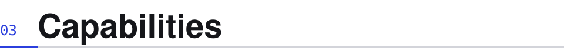</picture></h2>

<table>
<tr><td width="64"></td><th align="left" width="130">Languages</th><td><code>Python</code> <code>Dart</code> <code>TypeScript</code> <code>JavaScript</code> <code>HTML</code> <code>CSS</code></td></tr>
<tr><td></td><th align="left">Frontend</th><td><code>React</code> <code>Next.js</code> <code>Vite</code> <code>Tailwind CSS</code> <code>Framer Motion</code> <code>Chrome extensions (MV3)</code></td></tr>
<tr><td></td><th align="left">Backend</th><td><code>Django</code> <code>Django REST Framework</code> <code>Node.js</code> <code>Express</code> <code>Prisma</code> <code>Auth.js</code> <code>JWT</code> <code>Zod</code></td></tr>
<tr><td></td><th align="left">Mobile</th><td><code>Flutter</code> <code>Dart</code> <code>Provider</code> <code>Go Router</code> <code>on-device SQLite</code></td></tr>
<tr><td></td><th align="left">AI / ML</th><td><code>MediaPipe</code> <code>OpenCV</code> <code>YOLOv8</code> <code>scikit-learn</code> <code>NumPy</code> <code>Streamlit</code> <code>LLM APIs via OpenRouter</code></td></tr>
<tr><td></td><th align="left">Databases</th><td><code>PostgreSQL</code> <code>MongoDB</code> <code>SQLite</code></td></tr>
<tr><td></td><th align="left">Developer tools</th><td><code>Git</code> <code>GitHub</code> <code>Docker</code> <code>Postman</code> <code>Vercel</code> <code>Render</code> <code>Cloudinary</code></td></tr>
<tr><td></td><th align="left">Design tools</th><td><code>Figma</code> <code>Photoshop</code> <code>Canva</code></td></tr>
</table>

<h2><picture><source media="(prefers-color-scheme: dark)" srcset="assets/h-now-dark.svg">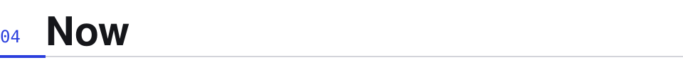</picture></h2>

<table>
<tr><th align="left" width="210">Full-stack product work</th><td>Finishing things end to end. Pockiva shipped as an APK, EduSphere's role modules keep growing, and WayFind has both an admin side and a public side.</td></tr>
<tr><th align="left">AI-powered applications</th><td>Moving from single-model demos like SignSpeak and Fridge Chef toward products that wrap a model in real accounts, screens and data.</td></tr>
<tr><th align="left">Spatial intelligence</th><td>Navigation graphs, A* routing and QR positioning in WayFind, plus a campus map view inside EduSphere.</td></tr>
<tr><th align="left">Better engineering practice</th><td>Writing things down as I build: API docs, testing guides and a production checklist in EduSphere, phase-by-phase READMEs in WayFind.</td></tr>
<tr><th align="left">Creative UI</th><td>Giving each project its own identity: MovieVerse's marquee look, my <a href="https://humraz.vercel.app/">portfolio's</a> desk-and-terminal workspace, and this page.</td></tr>
</table>

<h2><picture><source media="(prefers-color-scheme: dark)" srcset="assets/h-beyond-dark.svg"></picture></h2>

<picture><source media="(prefers-color-scheme: dark)" srcset="assets/beyond-dark.svg">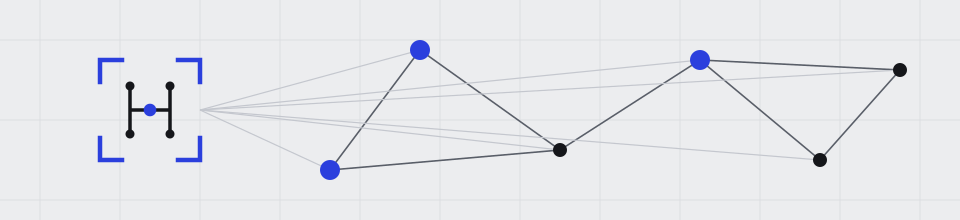</picture>

Writing software is half of how I learn. The other half is being around other students who are learning too.

I'm the **MuLearn Campus Lead at MESCAS**, and I'm part of **BYTE BEGIN**, our Computer Science department's association, where I built the association's website. Before any of that there was design: **Origin Media** is the creative brand I started, and it's why I still care how a screen feels.

<table>
<tr><th align="left" width="210"><a href="https://github.com/mhd-humraz/mescas">MESCAS chapter site</a></th><td>The MuLearn campus chapter's website, a team effort. 38 of its 104 commits are mine.</td></tr>
<tr><th align="left"><a href="https://github.com/mhd-humraz/byte-begin-website">BYTE BEGIN website</a></th><td>The department association's site for events, resources and community. 32 of its 58 commits are mine.</td></tr>
</table>

<h2><picture><source media="(prefers-color-scheme: dark)" srcset="assets/h-activity-dark.svg"></picture></h2>

<picture>
  <source media="(prefers-color-scheme: dark)" srcset="assets/activity-dark.svg">
  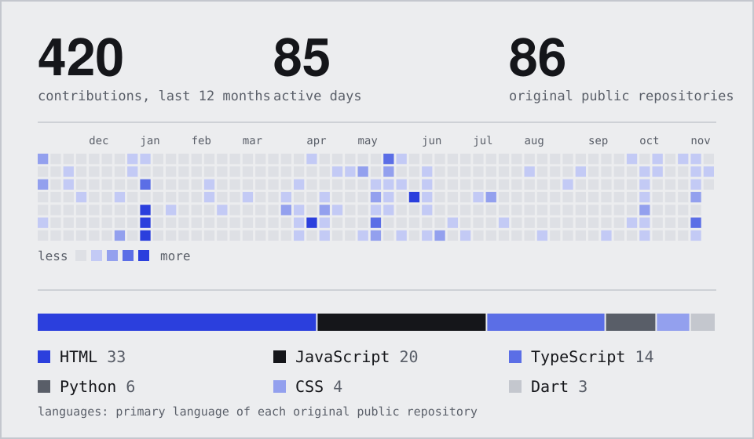
</picture>

Drawn from public GitHub data by <a href="scripts/update_activity.py">a script in this repo</a> and refreshed weekly by a <a href=".github/workflows/update-activity.yml">workflow</a>, so there are no third-party widgets to break.

<h2><picture><source media="(prefers-color-scheme: dark)" srcset="assets/h-contact-dark.svg">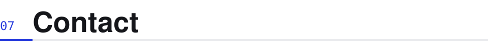</picture></h2>

<picture>
  <source media="(prefers-color-scheme: dark)" srcset="assets/closing-dark.svg">
  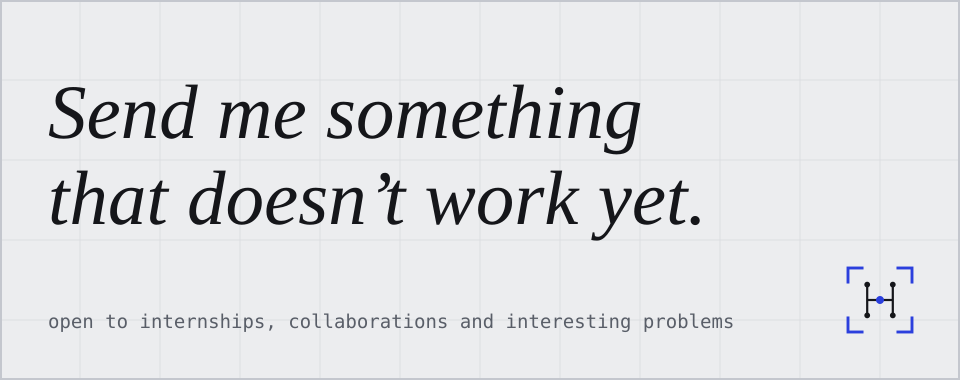
</picture>

<table>
<tr><th align="left" width="130">Portfolio</th><td><a href="https://humraz.vercel.app/">humraz.vercel.app</a></td></tr>
<tr><th align="left">LinkedIn</th><td><a href="https://www.linkedin.com/in/mhd-humraz-283a5435b">mhd-humraz</a></td></tr>
<tr><th align="left">GitHub</th><td><a href="https://github.com/mhd-humraz">@mhd-humraz</a></td></tr>
<tr><th align="left">Email</th><td><a href="mailto:humrazofficial1@gmail.com">humrazofficial1@gmail.com</a></td></tr>
</table>

<a href="#top">Back to top</a>

